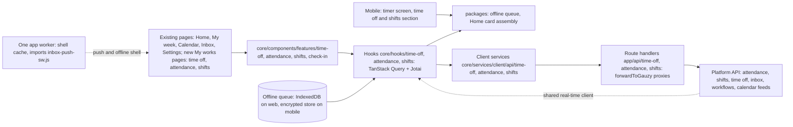

# Implementation Plan: Time, attendance and leave in Ever Teams

> Translates an approved `spec.md` into routes, components, hooks, services and flags.
> The plan owns implementation details; the spec owns behaviour.

**Feature ID**: `people-self-service`
**Spec**: `./spec.md`
**Tasks**: `./tasks.md`
**Status**: `Draft`
**Last updated**: 2026-11-23

---

## 1. Architecture Summary

Ever Teams stays a client: every record and rule comes from the platform specs named in the spec header, and the app
depends on no `@gauzy/*` package. This feature is a set of additions to screens Ever Teams already has, signed in
through the existing `withAuthentication` (`core/components/layouts/app/authenticator.tsx`) and its session state:

- **Home** (`app/[locale]/page-component.tsx`: `TaskTimerSection`, `TeamLiveSummary`, daily plans) and **My week**
  (`core/components/dashboards/my-week/*`) gain cards; the team member cards (`TeamLiveSummary`,
  `core/components/dashboards/team/team-today-card.tsx`) gain attendance and time-off status.
- **Header timer** gains the check-in button beside it (`core/components/timer/`).
- **Calendar** (`core/components/calendar/calendar-page.tsx`: time grid, month view, day panel) gains layers for
  attendance days, shifts, time off and holidays; it stays the member time calendar.
- **Inbox** (`core/components/pages/inbox/inbox-page.tsx`, `inbox-decision.tsx`, `core/lib/utils/inbox-entry.ts`) gains a
  Decisions view, swipe and undo on decision rows, and bulk decisions; the platform's approval engine already writes
  every approval task there as an Inbox item of kind `APPROVAL`.
- **Settings → Profile** (`core/components/settings/pages/profile/profile-settings-page.tsx`, entries in
  `core/components/settings/kit/settings-entries.ts`) gains a read-only work section; its existing rows and rates section
  (`rates-section.tsx`) stay as they are.
- **Sidebar** group "My works" (`core/components/layouts/app-sidebar.tsx`) gains Time off, Attendance and Shifts pages;
  the command palette (`core/lib/utils/palette-items.ts`) gains check in and request time off.
- **Offline**: `core/components/common/offline-wrapper.tsx` (mounted by `app/[locale]/(main)/layout.tsx`) today
  unmounts every page while offline; it gains an offline-capable route list rendered from cache with a banner.
- **Push**: the existing inbox push (`core/hooks/inbox/use-inbox-web-push.ts`,
  `core/services/client/api/inbox/inbox-push.service.ts`, `public/inbox-push-sw.js`, `core/lib/utils/web-push.ts`,
  Settings → Notifications `notification-push-section.tsx`) carries the new kinds.

Logic both clients share (the offline queue engine, conflict classification, Home card assembly, attachment resizing)
lives in `packages/` so the mobile app reuses it. The offline queue is also the queue of `workspace-collaboration-clients`
(chat sends and shares are kinds of it). The app manifest, the app worker (shell cache, update prompt, inbox push), the
offline queue with its unsent badge, conflict review drawer and unsent prompt at sign-out, and the offline wrapper's
route list are shared by both features and are on while either of them is on for the tenant
(`core/lib/utils/app-worker.ts`); the cards, pages, offline routes and queue kinds of each feature follow its own flag.

## 2. Tech Choices

| Concern | Choice | Rationale |
| ------- | ------ | --------- |
| Data fetching | TanStack Query hooks in `core/hooks/{time-off,attendance,shifts}/`; keys `queryKeys.timeOff.*`, `queryKeys.attendance.*`, `queryKeys.shifts.*` in the existing `core/query/keys/index.ts` | Principle II; existing key registry |
| State | Jotai atoms in `core/stores/offline/` (queue view, conflicts) and the existing session atoms for the employee summary | Principle II; existing state management |
| Area availability | one helper `core/hooks/common/use-area-availability.ts` generalized from `core/hooks/docs/use-docs-availability.ts`, `core/hooks/inbox/use-inbox-availability.ts` and `core/hooks/ai/use-server-ai-availability.ts` (those keep their names and call it); flag helper `core/lib/utils/self-service-enabled.ts` in the pattern of the existing `*-enabled.ts` helpers | spec FR-2; one probe pattern for every Ever Teams area (also used by `workspace-collaboration-clients`) |
| Live updates | shared real-time client (`core/hooks/realtime/use-realtime-event.ts`) invalidating the three key groups; 60 s fallback while visible | Principle VII |
| Offline queue | pure engine in `packages/utils/src/offline-queue/` (ordering, idempotency keys, retry with backoff, conflict classification, kinds registered by features); storage adapters: IndexedDB (web), the existing `react-native-mmkv` store encrypted with a key in the secure store (mobile) | spec FR-19 to FR-23; one queue for every Ever Teams feature |
| Offline reading | `OfflineWrapper` gains a route list (Home, My week, Calendar, time off, attendance, shifts) rendered from the TanStack Query cache persisted to IndexedDB, under a banner; other routes keep the existing Offline page | spec FR-22; extends the existing wrapper |
| Installable app | `app/manifest.ts` (start URL `/`); one app worker `public/app-sw.js` (shell cache, update prompt, badge) that imports the existing `public/inbox-push-sw.js`; registered only while this feature or `workspace-collaboration-clients` is on; both registration paths (the worker registration and the push switch of `use-inbox-web-push.ts`) take the script from one helper `core/lib/utils/app-worker.ts`, so switching push on keeps `app-sw.js`; once both are off, a browser whose registration at `/` still runs `app-sw.js` gets `inbox-push-sw.js` back on the same registration (the registration of `app-sw.js` and this cleanup both run inside one cross-tab lock, `navigator.locks.request('app-worker')`, so they never interleave; inside the lock the cleanup asks the worker for its window clients and goes ahead only when this tab is the only one, otherwise the registration and the caches stay and the cleanup is left to a later page load; no other tab has to answer, and a tab that opens with a feature on registers `app-sw.js` again under the same lock; the cleanup itself deletes no cache: the app worker's caches are deleted on a later page load that finds the registration no longer running `app-sw.js` (or gone), a state in which no page can be served by `app-sw.js`, so a tab that loads while the cleanup runs keeps its caches) (its push subscription stays with the registration) or, without a push subscription, loses the registration, and the app worker's caches are deleted afterwards as stated | spec FR-3; nothing replaced; the push-only path of today stays as it is with the feature off |
| Approvals | the existing Inbox decision row answered in place; bulk through `POST /workflows/tasks/decide-bulk`; digest through the existing notification settings and inbox delivery digests | spec FR-46 to FR-49; one approvals list |
| UI | `core/components/common` wrappers, Tailwind tokens, central icons; swipe rows built on the common list primitives with button equivalents | Principle V |
| Gauzy web app links | runtime key `NEXT_PUBLIC_GAUZY_WEB_APP_URL` read through `readRuntimeEnv()`; links hidden when unset | spec FR-46, FR-52 |
| Flag | `NEXT_PUBLIC_PEOPLE_SELF_SERVICE_ENABLED` via `readRuntimeEnv()` offers the feature on a deployment; per tenant, `core/lib/utils/self-service-enabled.ts` also requires the tenant's feature code `FEATURE_TEAMS_PEOPLE_SELF_SERVICE` (shared: declared in the Ever Gauzy feature catalogue, off by default), read once per session from the tenant's feature toggles that `GET /user/me` returns with the relations `tenant.featureOrganizations` and `tenant.featureOrganizations.feature` (the route accepts these relations for any signed-in user; `getAuthenticatedUserData` of `core/services/client/api/users/user.service.ts` requests only `role` and `tenant` today and gains both relations, and `ITenant` of `core/types/interfaces/tenant/tenant.ts` gains `featureOrganizations`, task T1; in proxy mode the read goes through `app/api/user/me/route.ts`, whose guard calls `currentAuthenticatedUserRequest` of `core/services/server/requests/auth.ts`, and its default relations gain the same two; a code without a toggle row reads as off; the gate is per workspace, and an Ever Teams workspace is one tenant: among the tenant's toggle rows of the code, the row of the session's active organization decides and the row without an organization is the tenant's default) and kept in the session state; the mobile app reads the same key from its runtime config and the same toggle | Principle IV; a tenant-level setting the platform already stores, with a default for new tenants |

## 3. Platform API Used

Data model: none (server model: `attendance-and-shifts`, `time-off-management`, `approval-workflows`,
`calendar-and-scheduling`). The endpoints below are defined in those platform plans or exist in the platform today;
this client consumes them as they are. Time off ships first on the existing core routes and switches to the
`time-off-management` routes when the area probe finds them.

| Method | Endpoint | Purpose | Platform spec |
| ------ | -------- | ------- | ------------- |
| `GET` | `/employee/me`, `/auth/*` (existing sign-in, refresh, request and reset password, two-factor) | session, employee summary with position and department | existing |
| `GET` | existing `/user/me`, whose relations requested by `getAuthenticatedUserData` gain `tenant.featureOrganizations` and `tenant.featureOrganizations.feature` (T1) | the tenant's toggle of `FEATURE_TEAMS_PEOPLE_SELF_SERVICE` | existing route, which accepts these relations for any signed-in user; the code is an entry of the platform's feature catalogue |
| `GET/POST/PUT` | `/time-off-request`, `/time-off-policy`, `/time-off-balance`, `/official-holiday` | first slice: my requests, policies, balances, holidays | existing |
| `GET/POST` | `/attendance/me/status`, `/attendance/me/check-ins`, `/attendance/me/offline-batch`, `/attendance/me/phone-code` | check-in state, check-in, queued check-ins, kiosk code | `attendance-and-shifts` |
| `GET` | `/attendance/me/days`, `/attendance/calendar`, `/attendance/days/:id/changes` | recent check-ins, Calendar layer, day sources | `attendance-and-shifts` |
| `GET/POST` | `/attendance/me/exceptions`, `/attendance/exceptions/:id/resolve` | exceptions and one-step resolutions | `attendance-and-shifts` |
| `GET/POST/PUT` | `/attendance/requests` (+ `/:id/submit`, `/:id/cancel`), `POST /attendance/requests/preview`, `/attendance/overtime-requests` | remote, off-site, corrections, overtime | `attendance-and-shifts` |
| `GET` | `/attendance/presence?teamId=` | in, off or late status on the existing team member cards | `attendance-and-shifts` |
| `GET/POST` | `/shifts/me/roster`, `/shifts/requests`, `/shifts/open-shifts` (+ `/:id/volunteer`, `/:id/pick`), `/shifts/trades` (+ `/:id/accept`, `/:id/decline`, `/:id/withdraw`) | my shifts, requests, open shifts, trades | `attendance-and-shifts` |
| `GET` | `/time-off/balances/me`, `/time-off/balances/:id/ledger`, `/time-off/balances/projection` | balances with derivations and projection | `time-off-management` |
| `POST/PUT` | `/time-off/requests/preview`, `/time-off/requests`, `/time-off/requests/:id`, `/:id/withdraw` | request flow | `time-off-management` |
| `GET` | `/time-off/working-calendar`, `/time-off/expected-hours`, `/time-off/calendar` | holidays, expected hours, team layer | `time-off-management` |
| `GET/POST` | `/time-off/compensatory-claims` (+ `/:id/submit`) | compensatory claims | `time-off-management` |
| `GET/POST` | `/calendar/feeds` | my personal feed address (time off and shifts are layers of it) | `calendar-and-scheduling` |
| `GET/POST` | existing `/inbox/items`, `/inbox/items/counts` and the decision reply used by `inbox-decision.tsx`; `POST /workflows/tasks/decide-bulk` | Decisions view, single and bulk decisions | existing inbox; `approval-workflows` |
| `GET/POST/DELETE` | `/inbox/push-subscriptions` (+ `/public-key`); `PUT /employee-notification-setting/:id` | push devices, per-kind choices, digest time | existing inbox; `automation-and-notifications` |

Every writing call carries an `Idempotency-Key` (the queued action's client id, the same on every retry) and, where the
platform asks for it, the record version. A repeated key is answered by the platform's idempotency kernel: the first
answer again with `Idempotency-Replayed: true`, `409` `IDEMPOTENCY_IN_PROGRESS` with `Retry-After` while the first
request still runs, `409` `IDEMPOTENCY_KEY_REUSED` for another payload under the same key; the offline batch also
ignores a check-in whose client event id it already holds. `409` answers about the record (changed or decided
elsewhere) refresh the record and feed the conflict review; the idempotency answers are read as in §6. Timesheet approvals are not called here:
their Inbox rows open the existing Timesheets page (`core/components/dashboards/timesheets/timesheet-status.tsx`).

## 4. Types and Schemas

- Interfaces in `core/types/interfaces/{time-off,attendance,shifts,offline}/`, matching the platform contracts
  (`attendance-and-shifts`, `time-off-management`, the existing `time-off-request` and `inbox` models).
- Zod schemas in `core/types/schemas/{time-off,attendance,shifts,offline}/` for every platform response read offline and
  every queued payload (validated before storing and before replay).
- Promoted to `@ever-teams/types` (`packages/types/src/time-attendance/`) because the mobile app uses them.

## 5. Services and Route Handlers

- Client services `core/services/client/api/{time-off,attendance,shifts}/*.service.ts`, each a thin wrapper of the
  routes in §3 with the tenant and organization headers; the existing `inbox` services gain bulk decisions.
- Server requests `core/services/server/requests/{time-off,attendance,shifts}/*.ts` and proxy route handlers
  `app/api/{time-off,attendance,shifts}/**/route.ts` (validate → forward → response) with the existing
  `forwardToGauzy` (`core/services/server/forward-to-gauzy.ts`), as the inbox routes do. Multipart uploads
  (attachments) stream through without buffering.
- No availability service of this feature: the areas register with the shared `use-area-availability.ts` (§2).

## 6. Hooks and State

| Hook | Query key / atom | Purpose |
| ---- | ---------------- | ------- |
| `useAreaAvailability(area)` for `attendance`, `shifts`, `timeOff` | `areas.<name>` | which areas show (FR-2) |
| `useHomeTimeCards` | built from the area queries | Home and My week cards, each with its own state (FR-10 to FR-12) |
| `useCheckInState`, `useCheckIn`, `useLocationOnce` | `attendance.status`; queue | one-tap check-in with location at the tap (FR-13 to FR-18) |
| `useMyCheckIns`, `useAttendanceLayer`, `useAttendanceExceptions`, `useAttendanceRequest`, `useTeamPresence` | `attendance.*` | lists, Calendar layer, exceptions, requests, member card status (FR-29 to FR-31, FR-50) |
| `useMyShifts`, `useOpenShifts`, `useShiftTrades`, `useShiftRequest` | `shifts.*` | shifts (FR-32, FR-33) |
| `useTimeOffBalances`, `useTimeOffPreview`, `useTimeOffRequests`, `useTimeOffRequest`, `useHolidays`, `useCompensatoryClaim`, `useCalendarFeed` | `timeOff.*` | time off (FR-24 to FR-28) |
| existing inbox hooks + `useInboxDecisionsView`, `useBulkDecide` | `inbox.*`; `pendingUndoAtom` | Decisions view, swipe with undo, bulk (FR-46 to FR-51) |
| existing `use-inbox-web-push.ts` + `useInstallPrompt`, `useAppBadge` | `installPromptAtom` | push, install, badge (FR-3, FR-54, FR-55) |
| `useOfflineQueue`, `useSyncConflicts`, `useQueueReplay` | `offlineQueueAtom`, `syncConflictsAtom` | queue, replay on reconnect, conflict review (FR-19 to FR-23) |

Mutations go through `useQueuedMutation(kind)`: online it sends at once with the client id as idempotency key; offline
or on a network error it stores the action with that same client id and updates the cache optimistically; the replay
sends in sequence, every retry under the action's client id, and classifies refusals into conflicts (`CHANGED`,
`DECIDED`, `LOCKED`, `OVERLAP`, `TOO_OLD`, `FORBIDDEN`, `INVALID`). Answers to a repeated key: a replayed first answer
counts as that answer (a success marks the item sent; a refusal is classified as above), `IDEMPOTENCY_IN_PROGRESS`
waits for `Retry-After` and retries under the same key, `IDEMPOTENCY_KEY_REUSED` is `INVALID`. A retry after editing in
the conflict review is a new action with a new client id.

## 7. Pages, Components and Navigation

- Extended pages: Home (cards row), My week (week layers), Calendar (layer switches for attendance, shifts, time off,
  holidays; day panel sources), Inbox (Decisions view, swipe rows, bulk bar), Settings → Profile (work section with the
  Gauzy web app link), Settings → Preferences (install choice), Settings → Notifications (digest time).
- New pages under `app/[locale]/(main)/`: `time-off/` (+ `new/`, `[id]/`), `attendance/` (exceptions and requests; the
  month view is the Calendar layer), `shifts/`; listed in the "My works" sidebar group. All inside the existing `(main)`
  group with `withAuthentication`, behind the flag (redirect home when off).
- Components under `core/components/features/{check-in,time-off,attendance,shifts,offline}/`: check-in button with
  location states (mounted beside the header timer and on Home), Home cards, Calendar layer renderers for the existing
  grid, request forms with preview panels, the unsent-items badge in the header and a conflict review drawer opened
  from it (no page of its own).
- `app/manifest.ts` (name, icons, standalone, start URL `/`), `public/app-sw.js` registered by
  `core/components/features/offline/register-app-worker.tsx` only while this feature or
  `workspace-collaboration-clients` is on; the component is mounted in `app/[locale]/(main)/layout.tsx` whatever the
  flags, so that once both are off it puts the existing `inbox-push-sw.js` back on the registration at `/` (or removes
  a registration without a push subscription) and deletes the app worker's caches; on a browser that never ran the app
  worker it does nothing.
- i18n namespaces `timeOff.*`, `attendance.*`, `shifts.*`, `offline.*` in every file of `apps/web/locales/`; cspell
  words added.

## 8. Other Clients

- **Mobile (`apps/mobile`)**: check-in on the existing timer screen; a time off and shifts section added to
  `app/navigators/authenticated-navigator.tsx` beside timer, team, profile and settings, with screens under
  `app/screens/authenticated/time/`; the work section on the existing profile screen; reusing the shared types, queue
  engine and Home card assembly; attachments through the existing `expo-image-picker`. Phase 2: check-in (device
  location at the tap), time off, Inbox decisions, push registration. Phase 3: shifts, attendance requests and layers.
  Language tables in `app/i18n/*` for every shipped language.
- **Desktop** (`apps/server-web`): shows the web screens; nothing else.
- **Browser extension** (`apps/extensions/components/popup/`): a check-in and check-out button beside the existing timer
  and the Inbox decisions count (Phase 3).
- Packages touched: `@ever-teams/types` (time and attendance types), `packages/utils` (offline queue engine, conflict
  classifier, image resize rules, Home card assembly).

## 9. Security & Privacy

- The app shows what the platform returns for the caller and hides areas and actions the platform forbids; it never
  decides access itself. Own requests never appear in the Decisions view (filtered by requester as well).
- Web tokens stay server-side as today; the mobile token stays in the secure store; the mobile cache and queue are
  encrypted with a key in the secure store. Sign-out with unsent items first asks to send them (when online), discard
  them or stay signed in; the cache and the queue are then wiped on web and mobile, so nothing of the account stays on
  the device.
- Location: read once at the tap through the browser or device API with a 10-second timeout and sent with the
  check-in; an online check-in keeps nothing on the device; a check-in queued offline carries the tap's coordinates in
  its queue entry only (the encrypted queue store on mobile; never in the query cache or logs), removed as soon as the
  platform has answered the item (accepted or refused), when it is discarded, when it passes the platform's offline age
  limit (default 7 days) and at sign-out; no map tiles, so no outbound call is added to `docs/ever-platform/outbound-calls.md`.
- User content (comments, reasons) rendered as text; links open safely; uploaded images stripped of their location
  metadata before upload.

## 10. Phased Rollout

1. **Types, services, hooks** (flag off): types and schemas, services and proxy routes, the shared availability helper,
   queue engine and adapters, hooks with tests.
2. **Screens** (flag off; reachable in dev with the flag on): check-in beside the timer, Home and My week cards, time off
   pages, Inbox Decisions view, Settings profile section, offline banner and conflict drawer, manifest and app worker;
   mobile Phase 2.
3. **Live updates, notifications and depth**: real-time invalidation, push on web and mobile, digest time, swipe and
   bulk decisions, Calendar layers, attendance requests, shifts, Home prompts; mobile Phase 3; extension button.
4. **General availability**: the feature is off by default (the runtime flag off on a deployment, the tenant's code `FEATURE_TEAMS_PEOPLE_SELF_SERVICE` off); after the trial period the code may be switched on by default for new tenants only (its default in the platform's feature catalogue, which gives each new tenant its own toggle); existing tenants keep their stored toggle until an administrator changes it in the platform's feature settings.

## 11. Constitution Reconciliation

- I Platform API is the backend: no business data stored; route handlers proxy; endpoints in §3 belong to the platform.
- II Layered web app: services → hooks → stores → components → pages per area.
- III Every string translated: the new namespaces in every web locale; mobile tables for every language.
- IV Runtime config; default-off flag; nothing removed: one runtime flag; the inbox push worker is imported, not
  replaced; Home, Inbox, Calendar, Settings and the offline page are extended, not replaced.
- V One design system: common wrappers, tokens, central icons; no new component library.
- VI Security and privacy: secure store, encrypted cache, location at the tap, no new outbound calls.
- VII Real-time through the platform channel: shared client; 60-second fallback documented.
- VIII Multi-client parity stated: §8; shared logic in packages.
- IX Tests and gates: Jest for hooks, services, queue and classifier; rendering tests for pages; before-merge gate.
- X Behaviour-first spec: implementation lives here.
- XI Documentation describes our product only.

## 12. Risks & Mitigations

| Risk | Likelihood | Impact | Mitigation |
| ---- | ---------- | ------ | ---------- |
| Platform areas land at different times | High | Medium | per-area probe; time off ships on the existing core routes first; each area ships independently behind the same flag |
| Two service workers on one scope | Medium | High | one app worker importing the inbox push handler; registration only with the feature on; one helper picks the script for both registration paths; once off, the inbox push worker is put back with its subscription and push delivery is tested after the switch |
| Offline wrapper change exposes a page that cannot render from cache | Medium | Medium | explicit route list; every listed page has a cache test; others keep the existing Offline page |
| Replayed actions after a long offline period surprise approvers | Medium | Medium | platform age limit; conflict review; decisions carry the record version |
| Mobile push registration unavailable on the platform | High | Low | in-app list and live updates (spec §8) |
| Lost queue on app update | Low | High | storage versioned with migrations; queue drained before schema changes |

## 13. References

- Spec: `./spec.md` · Tasks: `./tasks.md`
- Platform specs: [`attendance-and-shifts`](https://github.com/ever-co/ever-gauzy/blob/develop/docs/specs/features/attendance-and-shifts/spec.md), [`time-off-management`](https://github.com/ever-co/ever-gauzy/blob/develop/docs/specs/features/time-off-management/spec.md), [`approval-workflows`](https://github.com/ever-co/ever-gauzy/blob/develop/docs/specs/features/approval-workflows/spec.md), [`calendar-and-scheduling`](https://github.com/ever-co/ever-gauzy/blob/develop/docs/specs/features/calendar-and-scheduling/spec.md),
  [`automation-and-notifications`](https://github.com/ever-co/ever-gauzy/blob/develop/docs/specs/features/automation-and-notifications/spec.md)
- Related features: [`inbox`](../inbox/spec.md) (push devices, decisions), [`realtime-client`](../realtime-client/spec.md), [`workspace-collaboration-clients`](../workspace-collaboration-clients/spec.md) (shares the
  offline queue, availability helper and app worker)
- Code: `apps/web/app/[locale]/page-component.tsx`, `apps/web/core/components/dashboards/my-week/`,
  `apps/web/core/components/calendar/calendar-page.tsx`, `apps/web/core/components/pages/inbox/`,
  `apps/web/core/lib/utils/inbox-entry.ts`, `apps/web/core/components/settings/pages/profile/profile-settings-page.tsx`,
  `apps/web/core/components/common/offline-wrapper.tsx`, `apps/web/core/hooks/docs/use-docs-availability.ts`,
  `apps/web/core/hooks/inbox/use-inbox-web-push.ts`, `apps/web/public/inbox-push-sw.js`,
  `apps/web/core/hooks/realtime/`, `apps/mobile/app/navigators/authenticated-navigator.tsx`,
  `apps/web/core/services/client/api/users/user.service.ts`, `apps/web/core/types/interfaces/tenant/tenant.ts`
