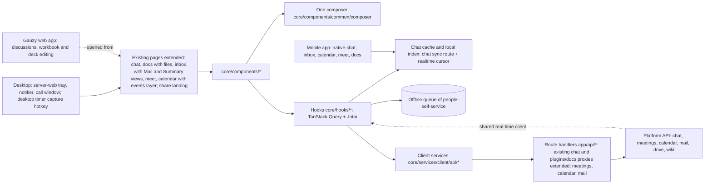

# Implementation Plan: Workspace collaboration clients

> Translates an approved `spec.md` into routes, components, hooks, services and flags.
> The plan owns implementation details; the spec owns behaviour.

**Feature ID**: `workspace-collaboration-clients`
**Spec**: `./spec.md`
**Tasks**: `./tasks.md`
**Status**: `Draft`
**Last updated**: 2026-11-23

---

## 1. Architecture Summary

Ever Teams stays a client and depends on no `@gauzy/*` package: every area is an Ever Teams screen over the platform
API. The existing chat, docs, inbox, meet and calendar pages are **extended in place** (their routes, services, hooks
and proxies keep working; new behaviour sits behind this feature's flag and their own). One concept, one screen:

- **Files** are the FILE kind of the platform's documents hub, the same `document` rows the Docs tree already lists as
  FOLDER and PAGE (`core/hooks/docs/use-docs-tree.ts` `TREE_KINDS`): the Docs area (`(main)/docs`, `docs/[pageId]`,
  `docs/trash`) gains files and the drive views; there is no second documents area, trash, recent list or proxy.
- **Mail** and **Summary** are views of the existing Inbox (`core/components/pages/inbox/inbox-page.tsx`), which
  already aggregates mentions, chat, docs, e-mail, integrations and people items and answers decisions in place; mail
  bodies render in the Inbox's existing e-mail view.
- **Calendar events, invitations and rooms** are a layer of the existing Calendar page
  (`core/components/calendar/calendar-page.tsx`), the member time calendar, which keeps its time grid, month view, day
  panel and split dialog; `people-self-service` adds its attendance, shift, time-off and holiday layers to the same
  layer list.
- **Meetings** stay on the existing meet pages over platform rooms and tokens; **chat** grows on the existing chat
  pages, services and hooks.
- **Discussions**, and the editing of **workbooks** and **decks**, open in the Gauzy web app (address from the runtime
  config of `people-self-service`); workbooks and decks are listed in the Docs tree as items of the hub.

Building blocks: (1) the existing screens extended; (2) a **chat cache** with a local index, kept current from the
chat sync route and the real-time client's cursor catch-up, whose offline sends are a kind of the app's one offline
queue (`people-self-service`); (3) **one composer** built from the chat composer and the comment composer. Push, the
area-availability check, offline storage, the app worker and the unsent prompt are those of `people-self-service`. The
app worker, the manifest, the offline queue with its unsent badge and conflict review, the unsent prompt and the
offline wrapper's route list are on while either feature is on for the tenant (`core/lib/utils/app-worker.ts` of
`people-self-service`), so this feature never needs the flag of `people-self-service`; its chat and Docs routes join
the offline route list with this feature's own flag.

## 2. Tech Choices

| Concern | Choice | Rationale |
| ------- | ------ | --------- |
| Data fetching | TanStack Query hooks per area in the existing folders (`core/hooks/{chat,docs,inbox}/`) and new `core/hooks/{meetings,calendar,mail}/`; keys in the existing `core/query/keys/index.ts` | Principle II |
| State | Jotai atoms in `core/stores/{chat,meetings,composer}/`; offline atoms of `people-self-service` | Principle II |
| Chat sync | `core/lib/chat-cache/`: conversations and messages cached on the device (IndexedDB on web and desktop, the encrypted `react-native-mmkv` store on mobile, the storage adapters of the offline queue), filled from `/chat/sync?cursor=&window=` and kept current by the real-time client's cursor catch-up (`core/lib/realtime/client.ts`, `GET /realtime/events`) where it carries chat events; drafts stay with `core/hooks/chat/use-chat-draft.ts` | spec FR-31; builds on the realtime cursor, no second engine |
| Offline sends | kind `chat.send` (and `share.send`) of the offline queue `packages/utils/src/offline-queue/` of `people-self-service`, with its conflict review | spec FR-31, FR-78; one queue, one storage adapter |
| Local search | a small full-text index over cached messages built in a worker (web, desktop) and on the device (mobile), tokenised per the message language | spec FR-18 |
| One composer | `core/components/common/composer/` generalized from `pages/chat/message-composer.tsx` and `tasks/drawer/comment-composer.tsx` (both kept as thin wrappers); targets declare what they accept | spec FR-74; nothing removed |
| Gauzy web app links | `NEXT_PUBLIC_GAUZY_WEB_APP_URL` of `people-self-service`; discussions, workbooks and decks open there at the record | spec FR-6, FR-68 to FR-73 |
| Meetings | the existing room screens keep their two media adapters; join tokens and rooms come from the platform when `/meetings/status` answers; the current token routes stay for the off case | spec FR-33; MEE FR-2 |
| Call window | the browser's document picture-in-picture where offered, else an in-page floating window; desktop always-on-top window; mobile system picture-in-picture | spec FR-41 |
| Share target | the app manifest share target of `people-self-service` plus a `/share` landing; mobile share extension; desktop "open with" and drop on the tray | spec FR-78 |
| Offline documents | per-item store of page state (live state where the page is live) and file bytes with version; background sync on reconnect and change hints | spec FR-81 |
| Writing help | the existing editor assist (`app/api/editor-assist/route.ts`, `core/hooks/ai/use-editor-assist.ts`, `rich-editor/editor-ai-panel.tsx`) calls the platform's `POST /documents/:id/writing` for Docs pages, whose answers arrive as suggestions, and keeps its current path for other editors; one writing menu | spec FR-67; one writing path per editor |
| Templates | the Docs home reads `/templates?kind=page`; the client list `core/lib/utils/docs-templates.ts` is used only while the platform does not answer (the platform seeds the same three page templates) | spec FR-64 |
| Live updates | shared real-time client (`core/lib/realtime/`); documented polling per area otherwise | Principle VII |
| UI | `core/components/common` wrappers, Tailwind tokens, central icons | Principle V |
| Flag | `NEXT_PUBLIC_COLLABORATION_CLIENTS_ENABLED` via `readRuntimeEnv()` offers the feature on a deployment; helper `core/lib/utils/collaboration-clients-enabled.ts` in the pattern of the existing `*-enabled.ts` helpers also requires, per tenant, the tenant's feature code `FEATURE_TEAMS_COLLABORATION_CLIENTS` (shared: declared in the Ever Gauzy feature catalogue, off by default), read once per session from the tenant's feature toggles that `GET /user/me` returns with the relations `tenant.featureOrganizations` and `tenant.featureOrganizations.feature` (the same session read as `people-self-service`: its task T1 adds both relations to `getAuthenticatedUserData` of `core/services/client/api/users/user.service.ts`, which requests only `role` and `tenant` today, and `featureOrganizations` to `ITenant`; the route accepts them for any signed-in user; in proxy mode the read goes through `app/api/user/me/route.ts`, whose guard calls `currentAuthenticatedUserRequest` of `core/services/server/requests/auth.ts`, and its default relations gain the same two in that task; a code without a toggle row reads as off; the gate is per workspace, and an Ever Teams workspace is one tenant: among the tenant's toggle rows of the code, the row of the session's active organization decides and the row without an organization is the tenant's default); the mobile and desktop apps read the same key and the same toggle; area helpers also read their page flag | Principle IV; a tenant-level setting the platform already stores, with a default for new tenants |

## 3. Platform API Used

Data model: none (server model: `chat-messaging`, `chat-agents-and-record-actions`, `chat-administration-and-clients`,
`meetings`, `calendar-and-scheduling`, `mail`, `drive`, `documents-and-wiki`). Endpoints are defined in those platform
plans and consumed as they are. Chat routes are under the chat plugin's `/chat` prefix; drive and wiki routes are under
`/plugins/docs`, the prefix the existing Docs proxies already forward.

| Method | Endpoint | Purpose | Platform spec |
| ------ | -------- | ------- | ------------- |
| `GET/PATCH` | `/chat/organizations/states`, `/chat/preferences`, `/chat/sections[/:id]` (+ `reorder`), `PUT /chat/conversations/:id/section` | switcher counts, appearance, sections | `chat-messaging` |
| `GET/POST/PATCH/DELETE` | `/chat/conversations[/:id]`, `/managers/:employeeId`, `/restore`, `/record`, `/convert`, `/links`, `/threads`; `POST /chat/notes` | channels, modes, panel, notes to self | `chat-messaging` |
| `GET/POST` | `/chat/people/:employeeId/profile`; `/chat/conversations/:id/messages`; `/chat/messages/:id/{context,revisions,forward,readers,translate}`; `POST /chat/messages/delete-batch` | people, stream, message actions | `chat-messaging` |
| `GET/POST/PATCH/DELETE` | `/chat/saved`, `/chat/messages/:id/save`, `/chat/reminders[/:id]`, `/chat/scheduled[/:id]`, `/chat/scheduled/suggestions`, `/chat/drafts[/:placeKey]`, `/chat/conversations/:id/polls` | Saved, Scheduled, drafts, polls | `chat-messaging` |
| `GET/POST/PUT` | `/chat/activity`, `/chat/saved/counts`, `/chat/status`, `/chat/statuses`, `/chat/states?sort=relevance`, `PATCH /chat/conversations/:id/state` | Activity, status, relevance | `chat-messaging` |
| `GET/POST` | `/chat/search`, `/chat/search/quick`, `/chat/links`, `/chat/conversations/:id/files`, `/chat/messages/:id/files/:documentId/{attach,save,grant-view}`, `/chat/messages/:id/files/zip` | search, files | `chat-messaging` |
| `POST/GET` | `/chat/conversations/:id/summary`, `/chat/records/:entity/:entityId/summary`, `/chat/digests/:id` | conversation and record summaries | `chat-messaging` |
| `GET/POST` | `/chat/conversations/:id/commands`, `/commands/:name/invoke`, `/chat/agent-runs/:id/stop`, `/chat/agent-plans/:id/{approve,cancel,change}`, `/steps/:n/undo`, `/chat/conversations/:id/agent-context/reset`, `/chat/prompts`, `/chat/conversations/:id/private-replies` | bots, agents, prompts | `chat-agents-and-record-actions` |
| `GET/PATCH/POST` | `/chat/cards?refs=`, `/chat/card-types`, `/chat/messages/:id/records/:entity/:entityId` (+ `transition`, `decision`), `/chat/records/:entity/:entityId/{send,discussions}` | record cards, send to chat | `chat-agents-and-record-actions` |
| `GET/POST/PATCH/DELETE` | `/chat/messages/:id/actions` (+ `run`), `/chat/conversations/:id/tool-commands[/:tool]`, `/subscriptions`, `/sources/mute`, `/bot-posts`, `/event-subscriptions`; `POST /chat/webhooks/:id/rotate` | actions, record posts, integrations panel | `chat-agents-and-record-actions` |
| `GET/POST` | `/chat/conversations/:id/rights`, `/chat/client-status`, `/chat/sync?cursor=&window=`, `/chat/share-in`, `/chat/messages/:id/share-out`, `/chat/files/:documentId/url`, `/chat/dlp/check`, `/chat/conversations/:id/calls` (+ `/calls/:id/{join,leave,end}`, `/calls/live`) | rights, states, sync, share, media, data-loss check, calls | `chat-administration-and-clients` |
| `GET` | existing `/realtime/events?cursor=` | cursor catch-up feeding the chat cache | existing |
| `GET` | existing `/user/me`, whose relations requested by `getAuthenticatedUserData` gain `tenant.featureOrganizations` and `tenant.featureOrganizations.feature` (`people-self-service` T1) | the tenant's toggle of `FEATURE_TEAMS_COLLABORATION_CLIENTS` | existing route, which accepts these relations for any signed-in user; the code is an entry of the platform's feature catalogue |
| `GET/POST/PATCH` | `/meetings/status`, `/meetings/rooms[/:id]`, `/rooms/by-key/:roomKey`, `/rooms/:id/{join,presence,lobby,agenda,links}`, `/meetings/lobby/:entryId/{admit,reject}`, `/meetings/sessions/:id/{mute-all,lower-hands,lock,unlock,end,polls,notes,recordings,summary,log-time}`, `/meetings/recordings[/:id]` (+ `stream`, `transcript`, `clips`), `/meetings/search`, `/meetings/schedule`, `/meetings/preferences/me` | rooms, lobby, host controls, recording, captions, notes, library | `meetings` |
| `GET/POST/PATCH/PUT` | `/calendar/calendars[/:id]` (+ `shares`, `my-settings`), `/calendar/events` (+ `send`, `cancel`, `answer`, `proposals`, `links`, `reminders/me`, `log-time`), `/calendar/records/:type/:id/events` | events layer, calendars, invitations, rooms | `calendar-and-scheduling` |
| `GET/POST` | `/mail/mailboxes` (+ `/:id/folders`), `/mail/messages?mailboxId=&folderId=&labelId=&view=`, `/mail/conversations/:threadId` (+ `snooze`, `mute`, `assign`, `state`, `remind`, `comments`, `records`), `/mail/messages/actions`, `/mail/drafts/**`, `/mail/identities`, `/mail/recipients`, `/mail/labels`, `/mail/search`, `/mail/messages/:emailId/attachments/:aid/save`, `/mail/mailboxes/:id/{rules,auto-reply/me,sender-review}` | Mail view of the Inbox, Summary mail items, composer replies | `mail` |
| `GET/POST/PUT/DELETE` | `/plugins/docs/uploads/**`, `/home`, `/recent`, `/shared-with-me`, `/documents?archived=only&scope=trash`, `/documents/:id/unarchive`, `/trash/empty`, `/documents/:id/{access,shares,public-links,versions}`, `/zips/**` with the core `/operations/:id`, `/storage/me`; the core `/employee-settings` (type `DOCS_VIEWS`) for view choices | files and drive views in Docs | `drive` |
| `POST` | the platform's AI chat conversation with a docs scope (folder or space) | ask a folder or space with citations | `drive`, `documents-and-wiki` |
| `GET/POST/PUT` | `/plugins/docs/documents/spaces`, `/wiki/spaces/:id/{members,history,follow}`, `/wiki/resolve`, `/documents/:id/{slug,suggestions,versions/compare,template,action-items/tasks,export.docx,export.html,export.odt,page-settings,writing}`, `/templates?kind=`, `/documents/from-template`, `/documents/meeting-notes`, `/wiki/change-requests/**`, `/review/queue` | docs depth | `documents-and-wiki` |
| existing | chat, docs, inbox (items, counts, decisions, e-mail), comments, entity files, scheduled meetings, `/inbox/push-subscriptions`, the real-time subscription | kept and extended | existing |

Writing calls carry an `Idempotency-Key` (the client key of an offline send or queued item) and, where asked, the
version read; `409` refreshes and, for queued items, feeds the conflict review of `people-self-service`.

## 4. Types and Schemas

- Interfaces in `core/types/interfaces/{chat,meetings,calendar,mail,docs,summary,composer,share,offline}/`, matching
  the platform contracts (`chat` models, `meeting.model.ts`, `calendar`, `mail`, `document` models with the FILE kind);
  Zod schemas in `core/types/schemas/` for everything stored on the device (chat cache, offline items, drafts) with a
  storage schema version.
- Promoted to `@ever-teams/types` (`packages/types/src/collaboration/`): chat cache, composer targets, Summary items,
  share intents, offline items, because mobile and desktop use them.

## 5. Services and Route Handlers

- Extended: `core/services/client/api/chat/chat.service.ts` (sections, activity, saved, scheduled, drafts, polls,
  search, rights, sync, share, calls, cards, agents, actions), `meetings/scheduled-meeting.service.ts` (platform
  rooms and scheduling when available), `docs/docs.service.ts` (files, uploads, drive views, trash fields, shares,
  versions, zips, wiki, suggestions, compare, templates, proposals), `documents/entity-files.service.ts` (Docs files on
  record panels), the inbox services (Mail and Summary views); their proxies `app/api/chat/**`,
  `app/api/plugins/docs/**` and the inbox routes gain the new routes.
- New: `core/services/client/api/{meetings/rooms,calendar/calendar-events,mail/mail}.service.ts` with proxies
  `app/api/{meetings,calendar,mail}/**/route.ts` (validate → forward → response, multipart streamed) through the existing
  `forwardToGauzy`.
- Area availability: the shared `core/hooks/common/use-area-availability.ts` of `people-self-service` (generalized from
  `use-docs-availability.ts` and `use-inbox-availability.ts`), with the areas of this feature registered (MEE
  `/meetings/status`, CAL capabilities, MAIL, DRV, DOC feature answers, `/chat/client-status`).
- The existing token routes `app/api/livekit/route.ts` and `app/api/auth/meet/jwt/route.ts` stay and are used only
  while the platform's meetings feature is absent.

## 6. Hooks and State

| Hook | Query key / atom | Purpose |
| ---- | ---------------- | ------- |
| `useAreaAvailability` (shared), `useClientState`, `useRights` | `areas.*`, `collab.clientState`, `chat.rights.<id>`; `clientStateAtom` | areas, banner, rights (FR-1 to FR-7) |
| `useChatViews`, `useSections`, `useChannelPanel`, `useChatPeople` | `chat.views.*`, `chat.sections`, `chat.conversation.<id>` | navigation, channels, people (FR-8 to FR-10, FR-21) |
| `useMessageActions`, `useStreamWindow`, `useThreads`, `useReactionsAndPolls` | `chat.messages.<id>`, `chat.threads` | actions, stream, threads, reactions, polls (FR-12 to FR-15) |
| `useSaved`, `useScheduled`, extended `use-chat-files.ts`, `useChatSearch`, `useActivity`, `useStatus` | `chat.saved`, `chat.scheduled`, `chat.files.<id>`, `chat.search`, `chat.activity`, `chat.status` | Saved, files, search, activity, status (FR-16 to FR-20, FR-22) |
| extended `use-chat-draft.ts`, `use-chat-link-previews.ts` | `chat.drafts`, `chat.linkPreviews` | drafts per place on the server, link previews (FR-11, FR-13) |
| `useAgents`, `useRecordCards`, `useMessageActionsRun`, extended `use-chat-webhooks.ts` | `chat.agents.*`, `chat.cards`, `chat.actions`, `chat.webhooks` | bots, agents, cards, actions, integrations panel (FR-23 to FR-26) |
| `useGuests`, `useDataLossCheck`, `useCalls` | `chat.calls.<id>`; `liveCallAtom` | guests, data-loss, calls (FR-27 to FR-29) |
| `useChatSync`, `useMediaCache`; offline sends through `useQueuedMutation('chat.send')` | `chatSyncAtom`; queue of `people-self-service` | sync, offline, media (FR-31, FR-32) |
| `useRoom`, `useLobby`, `useHostControls`, `useRecording`, `useCaptions`, `useMeetingNotes`, `useRecordings`, `useCallWindow` | `meetings.*`; `callWindowAtom` | meetings (FR-33 to FR-41) |
| `useCalendarEventsLayer`, `useInvitations`, `useAvailability`, `useResources`, `useBookingLinks` | `calendar.*` | events layer and calendar pieces (FR-42 to FR-48) |
| `useMailView`, `useMailConversation`, `useMailReply` | `mail.*` | Mail view of the Inbox, Summary and composer replies (FR-49 to FR-53) |
| extended `use-docs-tree.ts` (FILE kind, drive views; its `useDocsTrash` gains the trash fields), `use-docs-recent.ts` (server recent merged with the list the device keeps today, which stays the fallback; the tree's open nodes stay on the device), `use-docs-favorites.ts`, `use-docs-versions.ts`, `use-docs-zip-export.ts` (core operations); new `useDocsUpload`, `useDocsShares`, `useDocsSearch`, `useRecordFiles` | `docs.*`; `uploadsAtom` | files in Docs (FR-54 to FR-60) |
| `useWikiSpaces`, `useSuggestions`, `useVersionCompare`, `useTemplates`, `useProposals`, `usePageSettings` | `docs.*` | docs depth (FR-61 to FR-67) |
| `useComposer(target)` | `composerDraftsAtom`; drafts route per target | one composer (FR-74) |
| `useInboxSummary` | `inbox.summary` assembled | Summary view and summaries (FR-75 to FR-77) |
| `useShareIntent`, `useCapture` | `shareIntentAtom` | share target, hotkey, share out (FR-78 to FR-80) |
| `useOfflineItems` | `offline.items`; `offlineBudgetAtom` | offline documents and budget (FR-81, FR-82) |
| `useCollabLive`, `useCollabPush`, `useDeepLinks` | invalidation of `chat.*`, `meetings.*`, `calendar.*`, `mail.*`, `docs.*`, `inbox.*` | live, push, deep links (FR-83 to FR-85) |

`useComposer(target)` exposes one state machine (text, mentions, files, cards, voice, schedule) and a target adapter
(`chatMessage`, `threadReply`, `taskComment`, `pageComment`, `mailReply`) that declares accepted parts and turns the
rest into links with a notice. `useInboxSummary` reads the Inbox items the page already loads plus chat activity and
states, mail needing a reply, docs suggestions and comment mentions and meeting summaries waiting, merges them by
relevance or time and writes actions back to each source.

## 7. Pages, Components and Navigation

- Extended routes: `chat/` gains `activity/`, `saved/`, `scheduled/`, `people/`, `search/` beside the existing
  `unreads/`, `threads/`, `[conversationId]/`; `docs/` gains files in its tree, the views `home/`, `shared/`, `recent/`,
  `storage/` beside the tree, `spaces/[slug]/[...path]/`, `templates/`, `review/`, with `docs/trash/` kept as the one
  trash; `inbox/` gains the Mail view (`inbox/mail/[[...path]]/` for deep links) and the Summary view; `meet/` keeps
  `jitsi/`, `livekit/` and gains `rooms/[roomKey]/`, `recordings/[id]/`; `calendar/` gains the events layer and its
  dialogs.
- New route: only `share/` (share-target landing) under `app/[locale]/(main)/`, inside the existing `(main)` group with
  `withAuthentication`, behind the flag.
- Components: `core/components/common/composer/*` (one composer and target adapters), `core/components/pages/chat/*`
  extended (sections, channel panel, people, Saved, Scheduled, search, Activity, status, agent run and plan cards,
  record picker, call card, guest banner; `send-task-to-chat-dialog.tsx` grows into the record "Send to chat";
  `chat-webhooks-dialog.tsx` grows into the integrations panel), `core/components/pages/meet/*` extended (lobby, host
  controls, recording notice, captions, notes, summary review, call window), `core/components/pages/docs/*` extended
  (`docs-tree.tsx` with files and drive views, `docs-trash.tsx` with trash fields, upload, share dialog, suggestions,
  compare, templates, proposals, spaces), `core/components/pages/inbox/*` extended (Mail and Summary views),
  `core/components/calendar/*` extended (events layer, event dialogs), `core/components/share/*`,
  `core/components/offline/*`.
- Record pages (task drawer, project page) gain "Send to chat", "Discussed in", meetings, events and Docs files panels
  through the existing extension points of those pages.
- Help: `core/components/common/shortcuts-dialog.tsx` grows into the help panel, fed by `core/lib/keyboard/shortcuts.ts`,
  `core/lib/whats-new.ts` (`core/components/whats-new`) and the versions of `(main)/about`.
- Sidebar: no new entries; Chat, Docs, Inbox, Meet and Calendar show their counts; palette groups per area; shortcuts
  registered in the existing shortcut registry.
- i18n namespaces `chat.*`, `docs.*`, `inbox.*` (extended), `meet.*`, `calendar.*`, `mail.*`, `share.*` in every file of
  `apps/web/locales/`; cspell words added.

## 8. Other Clients

- **Mobile (`apps/mobile`)**: new tabs and stacks in `app/navigators/authenticated-navigator.tsx` with screens under
  `app/screens/authenticated/{chat,inbox,calendar,meet,docs}/`, built on the chat cache, the offline queue of
  `people-self-service`, the shared types and the one composer's state machine. Native: chat (gestures, haptics,
  compact composer with camera and voice), inbox with its Summary view, calendar agenda with answers, meeting join
  through the native client module of each media adapter, Docs files (browse, preview, upload, offline) and pages
  (reading with basic editing on the existing mobile rich editor). The Mail view as web screens inside the app. Share
  extension, push registration per `people-self-service`, native sign-in with a proof key (CA FR-27), language tables.
- **Desktop**: two apps exist and each extends what it already has. `apps/server-web` (Electron serving the web screens)
  adds the tray badge to `src/main/tray.ts`, native notifications with inline reply to `windows/desktop-notifier.ts`,
  call ringing, and the always-on-top call window through `src/main/helpers/create-window.ts`, plus "open with" as share
  target and offline items in the app's data folder. The capture hotkey ships in the Ever Teams desktop timer (built
  from the platform's desktop timer app, `apps/desktop/README.md`), which already has screen capture
  (`packages/desktop-lib/src/lib/desktop-screenshot.ts`), a tray, a notifier and an always-on-top window
  (`packages/desktop-window/src/lib/always-on.ts`) and knows the running task; it sends through the same upload and
  share routes.
- **Browser extension (`apps/extensions`)**: unread count on the icon and "share this page" to a conversation, a task
  or a page, in the existing popup.
- Packages touched: `@ever-teams/types` (collaboration types), `packages/utils` (composer target rules, Summary
  ranking, queue kinds `chat.send` and `share.send`).

## 9. Security & Privacy

- The app follows the platform's rights answers and share levels and never decides access itself; guests get the same
  screens with what the platform returns for them.
- Web tokens stay server-side; mobile and desktop keep tokens in their secure stores; the chat cache and offline items
  are encrypted on phones and removed at sign-out after the unsent prompt.
- Mail bodies render only inside the Inbox's isolated e-mail view; remote content follows the platform's consent and
  proxy; link previews come from the platform; blocked links never fetch.
- Data-loss checks run on the platform (`/chat/dlp/check`) before send; matched text is never logged by the client.
- Captions, transcripts and summaries come from the platform only; picture-in-picture keeps the same media session.
- Share targets accept only content the person handed over, and the hotkey captures only the region the person picks.
- Outbound calls: none added; media flows to the deployment's media servers as today.

## 10. Phased Rollout

1. **Types, services, hooks** (flag off): types and schemas, extended and new services and proxies, area registration,
   rights, client state, chat cache with local index, one composer state machine, hooks with tests.
2. **Pages** (flag off; dev with the flag on): chat depth, meetings over platform rooms, the Calendar events layer,
   files and drive views in Docs, docs depth, guests, data-loss checks, calls from conversations, record page panels.
3. **Live, notifications and advanced**: real-time invalidation everywhere, push kinds, deep links, one composer on
   every target, the Inbox Mail and Summary views, call window with captions, share target, offline documents, Gauzy
   web app links for discussions, workbooks and decks.
4. **Other clients and general availability**: mobile native screens and the Mail view inside the app, desktop
   tray, notifications, call window and capture hotkey, extension. The feature is off by default (the runtime flag off on a deployment, the tenant's code `FEATURE_TEAMS_COLLABORATION_CLIENTS` off); after the trial period the code may be switched on by default for new tenants only (its default in the platform's feature catalogue, which gives each new tenant its own toggle); existing tenants keep their stored toggle until an administrator changes it in the platform's feature settings.

## 11. Constitution Reconciliation

- I Platform API is the backend: no business data stored; proxies only; no platform UI package consumed.
- II Layered web app: services → hooks → stores → components → pages per area.
- III Every string translated: every namespace in every web locale; mobile and desktop tables.
- IV Runtime config; default-off flag; nothing removed: one new flag; chat, docs, inbox, meet, calendar, whiteboard,
  token routes, composers, client templates and editor assist kept and extended.
- V One design system: common wrappers, tokens, central icons.
- VI Security and privacy: rights from the platform, encrypted device data, isolated mail frame, no new outbound call.
- VII Real-time through the platform channel: one shared client, whose cursor also feeds the chat cache.
- VIII Multi-client parity stated: §8; types, composer rules and queue kinds in packages.
- IX Tests and gates: Jest for hooks, services, chat cache, local index, composer adapters, Summary ranking;
  rendering tests for pages; two-user checks for chat, calls and docs before general availability.
- X Behaviour-first spec: implementation lives here.
- XI Documentation describes our product only.

## 12. Risks & Mitigations

| Risk | Likelihood | Impact | Mitigation |
| ---- | ---------- | ------ | ---------- |
| Platform areas land at different times | High | Medium | per-area probe; each area ships independently behind the same flag |
| The Docs editor meets wiki nodes it does not know | Medium | High | `core/lib/docs-live/schema-guard.ts` and `pages/docs/docs-editor-extensions.ts` take the new nodes in the same release as the platform; the platform's schema-version check refuses older saves |
| Files make the Docs tree slow | Medium | Medium | the tree pages by folder; drive views list through their own routes; virtualized list |
| One composer regresses the existing chat or comment composer | Medium | High | old components become wrappers with their tests kept; target adapters tested per target |
| Chat cache grows on phones | Medium | Medium | platform window (200 per conversation), budget warning, media cache cap |
| Two token paths for meetings confuse links | Low | Medium | room names identical by MEE FR-3; one switch by `/meetings/status` |
| Push registration differs between specs | Medium | Medium | one device registration (spec §8 question); in-app badges and live updates until settled |
| Mobile media and share modules need a store build | High | Medium | ship with the first mobile release of this feature; feature-detect at run time |

## 13. References

- Spec: `./spec.md` · Tasks: `./tasks.md`
- Platform specs: [`chat-messaging`](https://github.com/ever-co/ever-gauzy/blob/develop/docs/specs/features/chat-messaging/spec.md), [`chat-agents-and-record-actions`](https://github.com/ever-co/ever-gauzy/blob/develop/docs/specs/features/chat-agents-and-record-actions/spec.md), [`chat-administration-and-clients`](https://github.com/ever-co/ever-gauzy/blob/develop/docs/specs/features/chat-administration-and-clients/spec.md), [`meetings`](https://github.com/ever-co/ever-gauzy/blob/develop/docs/specs/features/meetings/spec.md),
  [`calendar-and-scheduling`](https://github.com/ever-co/ever-gauzy/blob/develop/docs/specs/features/calendar-and-scheduling/spec.md), [`mail`](https://github.com/ever-co/ever-gauzy/blob/develop/docs/specs/features/mail/spec.md), [`drive`](https://github.com/ever-co/ever-gauzy/blob/develop/docs/specs/features/drive/spec.md), [`documents-and-wiki`](https://github.com/ever-co/ever-gauzy/blob/develop/docs/specs/features/documents-and-wiki/spec.md)
- Related features: [`chat`](../chat/spec.md), [`docs`](../docs/spec.md), [`inbox`](../inbox/spec.md), [`realtime-client`](../realtime-client/spec.md), [`comments-and-trash`](../comments-and-trash/spec.md), [`people-self-service`](../people-self-service/spec.md)
- Code: `apps/web/core/components/pages/chat/message-composer.tsx`, `apps/web/core/components/tasks/drawer/comment-composer.tsx`,
  `apps/web/core/services/client/api/chat/chat.service.ts`, `apps/web/core/hooks/chat/`,
  `apps/web/core/components/pages/chat/chat-webhooks-dialog.tsx`, `apps/web/core/components/pages/chat/send-task-to-chat-dialog.tsx`,
  `apps/web/core/services/client/api/meetings/scheduled-meeting.service.ts`, `apps/web/app/api/livekit/route.ts`,
  `apps/web/app/api/auth/meet/jwt/route.ts`, `apps/web/core/components/pages/meet/`,
  `apps/web/core/components/calendar/calendar-page.tsx`, `apps/web/core/components/pages/inbox/inbox-page.tsx`,
  `apps/web/core/services/client/api/docs/docs.service.ts`, `apps/web/app/api/plugins/docs/`, `apps/web/core/hooks/docs/`,
  `apps/web/core/services/client/api/documents/entity-files.service.ts`, `apps/web/core/lib/docs-live/`,
  `apps/web/core/lib/realtime/client.ts`, `apps/web/app/api/editor-assist/route.ts`,
  `apps/web/core/components/common/shortcuts-dialog.tsx`, `apps/server-web/src/main/`, `apps/mobile/app/navigators/`
